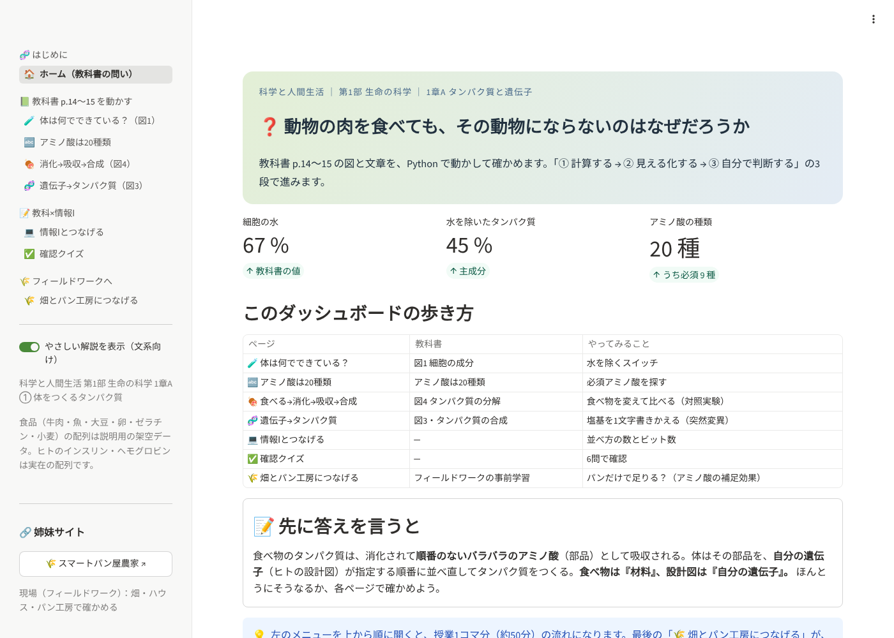
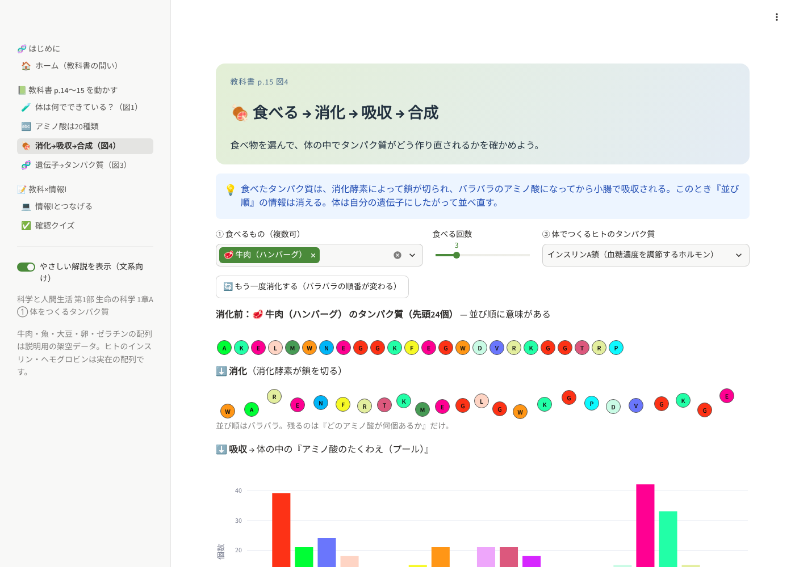
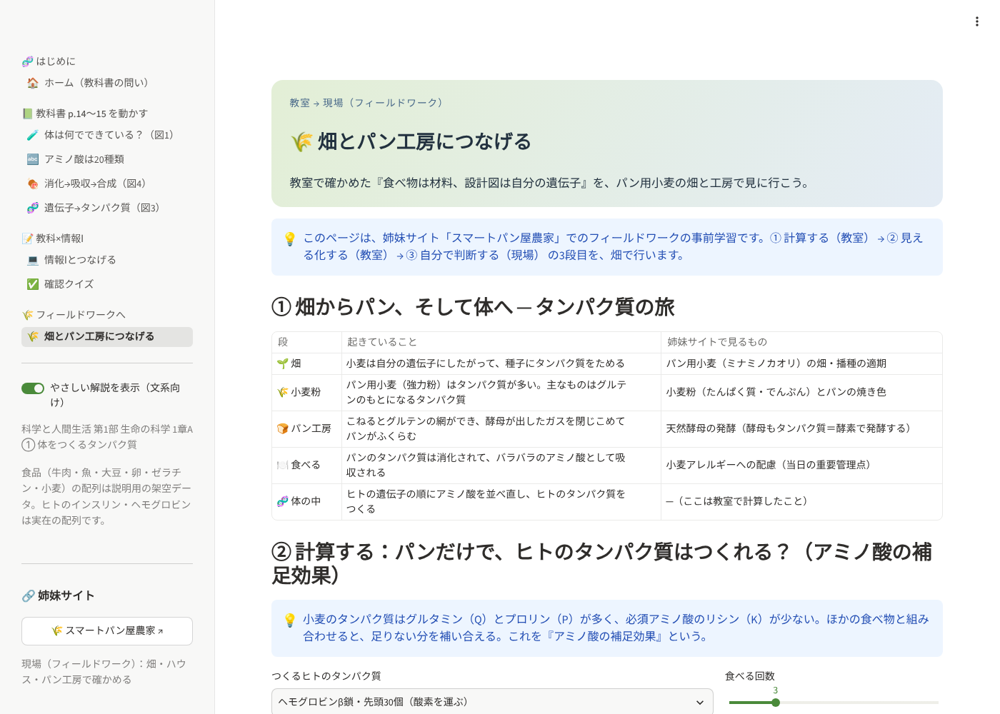
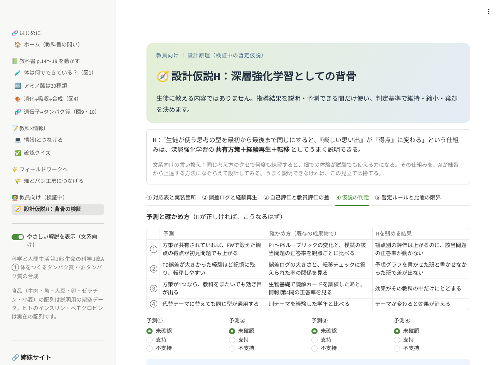

# 体をつくるタンパク質 ― 「科学と人間生活」×情報Ⅰ インタラクティブ教材

**▶ 公開ダッシュボード：<https://science-and-our-daily-life-dashboard-eemy7afzawym4gn656fjat.streamlit.app/>**



高校「科学と人間生活」第1部 生命の科学 1章A「タンパク質と遺伝子」① **体をつくるタンパク質**（教科書 p.14〜15）と
③ **タンパク質の合成**（p.18〜19）を、
Python と Streamlit で動かして確かめる教材です。

> ❓ **動物の肉を食べても、その動物にならないのはなぜだろうか。**

この問いに、**「① 計算する → ② 見える化する → ③ 自分で判断する」** の3段で答え、
最後に **🚀 次の一手：今後の人生戦略・戦術を立案する際のヒント集** へ持ち出します。
文系の生徒でも読めるよう、左メニューの「やさしい解説」スイッチで説明を出し入れできます。

## 🚀 出発点の問い ➡︎ 次の一手

```
❓ 動物の肉を食べても、その動物にならないのはなぜだろうか
   ↓ 各ページで計算・可視化・判断
💡 答え（原理）：取り込んだものは部品に分解され、自分の設計図にしたがって組み直される
   ↓
🚀 次の一手：今後の人生戦略・戦術を立案する際のヒント集
```

- **各ページの最後に「🏷️ 次の一手」タグ**：そのページで確かめた事実を、**戦略**（何を選び、何を捨てるか）と
  **戦術**（今週なにをするか）に持ち出すヒントを1つ表示（`ui.next_move_tag()`）。
- **最終ページ「🚀 次の一手」**（`pages/9_next.py`）：時期と悩みを選ぶと、12のヒントを合う順に並べ、
  探索（新しいことを試す）と活用（できることで得点する）の配分の目安を表示。
  「戦略・自分の必須アミノ酸・組み合わせる相手・今週の戦術・予想」を書く**次の一手シート**をテキストで保存できる。

| ヒント（抜粋） | 生物での事実 | 出どころ |
|---|---|---|
| 材料は外から、設計図は自分の中 | 食べたタンパク質は分解され、自分の遺伝子で並べ直される | 消化→吸収→合成 |
| 必須なのに自分でつくれないものを先に確保する | 必須アミノ酸は食べ物からとるしかない | アミノ酸は20種類 |
| いちばん足りないものが全体を止める | トリプトファンが1個足りないだけで合成できない | 消化→吸収→合成 |
| 足りないものは組み合わせで補う | 小麦＋大豆でリシン不足を補う（補足効果） | 畑とパン工房 |
| 少ない種類でも、並べ方で唯一の自分になる | 20種類でも4個並べれば16万通り | 情報Ⅰとつなげる |
| 小さな書きかえを、安く・たくさん試す | 1文字の変異で同義・置換・短縮 | 遺伝子→タンパク質 |

ヒントは**比喩**で、生物学の事実が人生の正解を決めるわけではありません（ページにも「比喩としての限界」を明記）。
データは `next_move.py`（Streamlit 非依存、`python next_move.py` で自己チェック）。

## 🦴 全ページ共通の「背骨」（思考の型）

教える内容はページごとに変わっても、**生徒が使う思考の型は最初から最後まで同じ**にしています
（「科学探究・フィールドワーク 連動指導ロードマップ」の背骨）。

| 背骨 | このダッシュボードでの形 | 置き場所 |
|---|---|---|
| ① 読解カード（4項目：軸・単位・統制・言える／言えない） | 各ページの **🔎 読解カード**。問いを先に見せ、答えは自分で考えてから開く | `ui.reading_card()` |
| ② 認知プロトコル P1〜P5 | 読解カード・予想・クイズに **P1〜P5 のラベル**。クイズはP別に正答数を出す | `backbone.PROTOCOLS` |
| 測る前に予想する（仮説シート項目5） | **🎯 先に予想しよう**（図1・遺伝子・情報Ⅰ）。答えとのずれ **δ** を表示 | `ui.predict()` |
| 「なぜ言えないか」で評価する | クイズの P3・P4 で理由を書く欄、**共通テスト型問題づくり**、転移チェック | `pages/6_quiz.py` |

### 🧭 教員向け：暫定的な設計仮説H（検証中）

左メニュー最下段「🧑‍🏫 教員向け（検証中）」。**生徒に教える内容ではなく、教員側の設計原理**で、しかも**検証中の暫定仮説**です。

> H：「生徒が使う思考の型を最初から最後まで同じにすると、『楽しい思い出』が『得点』に変わる」という仕組みは、
> 深層強化学習の**共有方策＋経験再生＋転移**としてうまく説明できる。

| タブ | できること |
|---|---|
| ① 対応表と実装箇所 | DRLの構成要素 ↔ ロードマップ ↔ **このダッシュボードのどこに実装したか** |
| ② 誤差ログと経験再生 | FWの例＋このセッションの予想から δ を計算し、**ずれの大きい経験ほど復習に出やすい**（優先度 (δ+0.01)^α）。JSONで手元に保存 |
| ③ 自己評価と教員評価の差 | P1〜P5 の A/B/C の差（Actor–Critic）。差が最大の観点＝個別指導の入口 |
| ④ 仮説の判定 | 予測①〜④の結果から **維持／縮小／棄却／保留** を判定（①が不支持なら棄却。④は参考） |
| ⑤ 暫定ルールと比喩の限界 | ルール3つと、それぞれの実装箇所。DRLの比喩が生徒に当てはまらない点 |

得点への寄与が大きいのは対応表の上3行（読み方と型を全ページで共通にすること）。経験再生などの実装は、
研究テーマ・生徒に見せる実例という位置づけにとどめています。

## 🔗 教材ネットワーク：姉妹サイト「スマートパン屋農家」

| | 🧬 体をつくるタンパク質（このリポジトリ・[公開アプリ](https://science-and-our-daily-life-dashboard-eemy7afzawym4gn656fjat.streamlit.app/)） | 🌾 [スマートパン屋農家](https://github.com/nayukaya3-cn/Smart-Bakery-Farmer_20260923)（[公開アプリ](https://smart-bakery-farm.streamlit.app/)） |
|---|---|---|
| 役割 | **教室**：教科書の1単元を Python で動かす（事前学習） | **現場**：畑・ハウス・パン工房で確かめる（フィールドワーク） |
| 3段構え | ① 計算する・② 見える化する | ③ 自分の条件で判断する |

教室で計算し、現場で判断し、現場で湧いた問いを教室でもう一度計算する。この往復を、ページどうしのリンクとして
**`sister_sites.py`（両リポジトリで同じ内容）** に1か所で定義しています。

| このサイトのページ | ⇄ | 姉妹サイトのページ | 共通の単元（学習指導要領の小項目） |
|---|---|---|---|
| 🏠 ホーム | ⇄ | 🏠 ホーム | ─ |
| 🍖 消化→吸収→合成 | ⇄ | 🔭 科学と人間生活＝FWの事前学習 | 衣料と食品／ヒトの生命現象 |
| 🌾 畑とパン工房につなげる | ⇄ | 🧭 フィールドワーク伴走 | 衣料と食品／ヒトの生命現象 |
| 🧬 遺伝子→タンパク質 | ⇄ | 🦠 微生物からの挑戦 | 微生物とその利用 |
| 💻 情報Ⅰとつなげる | ⇄ | 🔬 共通テスト『理科』を情報Ⅰで解く | ─ |

`sister_sites.py` を直したら、もう一方のリポジトリにも同じ内容でコピーし、`NETWORK_VERSION` を上げてください。
リンク先のページが実在するかは、各リポジトリのテストが確かめます（存在しないURLは相手のホームに飛んでしまうため）。

## ページ構成

| まとまり | ページ | 教科書 | やってみること | 情報Ⅰとのつながり |
|---|---|---|---|---|
| 🧬 はじめに | 🏠 ホーム | 導入の問い | 答えの見通し・背骨（読解カードとP1〜P5） | ─ |
| 📗 教科書を動かす | 🧪 体は何でできている？ | p.14 図1 細胞の成分 | 予想 → 「水を除く」スイッチ | データの可視化・割合（分母） |
| | 🔤 アミノ酸は20種類 | p.15 アミノ酸20種 | 必須アミノ酸を絞り込む | 文字コード |
| | 🍖 消化→吸収→合成 | p.15 図4・p.19 | 食べ物を変えて比べる（対照実験）・**どの食品から来たアミノ酸か** | 文字列の分解・辞書で集計 |
| | 🧬 遺伝子→タンパク質 | p.18〜19 図9・図10 | 塩基を1文字書きかえる・**鋳型鎖（相補性）**・**全部試す（総当たり）** | 対応表による変換・総当たり |
| 📝 教科×情報Ⅰ | 💻 情報Ⅰとつなげる | ─ | 予想 → 並べ方の数 20ⁿ とビット数 | 場合の数・情報量・DNCL |
| | ✅ 確認クイズ | ─ | 9問（P1〜P5別の集計）・理由を書く・問題づくり・転移チェック | ─ |
| 🌾 フィールドワークへ | 🌾 畑とパン工房につなげる | 事前学習 | 補足効果・問いのブリッジ・**FWの予想シート（CSV）** | 条件をそろえた比較 |
| 🚀 次の一手 | 🚀 人生戦略・戦術のヒント集 | ─ | 時期・悩みに合うヒント、探索と活用の配分、次の一手シート | 並べ替え（スコア順） |
| 🧑‍🏫 教員向け | 🧭 設計仮説H：背骨の検証 | ─ | 対応表・経験再生・Actor–Critic・判定 | 優先度付き抽選・確率 |







## 手元で動かす

```bash
git clone https://github.com/nayukaya3-cn/Science-and-Our-Daily-Life-dashboard.git
cd Science-and-Our-Daily-Life-dashboard
python -m venv .venv && source .venv/bin/activate   # Windows: .venv\Scripts\activate
pip install -r requirements.txt
streamlit run app.py
```

## Streamlit Community Cloud で公開する

1. このフォルダを GitHub に新しいリポジトリとして push する
2. <https://share.streamlit.io/> → **Create app** → リポジトリ・ブランチ `main`・Main file path に **`app.py`** を指定
3. App URL（例：`tanpakushitsu.streamlit.app`）を決めて **Deploy**
4. README 冒頭の URL を書きかえる

秘密情報（APIキーなど）は使っていないので、Secrets の設定は不要です。

## ファイル構成

```
app.py              入口（左メニューの組み立て。ページを足すときは NAV に1行足す）
home.py             ホーム
pages/              各ページ（1_seibun.py 〜 7_field.py、教員向け 8_kyoin.py、次の一手 9_next.py）
sister_sites.py     姉妹サイト（教材ネットワーク）の定義。両リポジトリで同じ内容
tanpaku_core.py     計算部品とデータ（Streamlit に依存しない。`python tanpaku_core.py` で自己チェック）
next_move.py        次の一手（人生戦略・戦術のヒント集とページごとのタグ）。`python next_move.py` で自己チェック
backbone.py         背骨（読解カード・P1〜P5）と設計仮説H（δ・経験再生・判定）。`python backbone.py` で自己チェック
ui.py               画面の共通部品（見出しカード・やさしい解説・アミノ酸の鎖・読解カード・予想→δ）
tests/              pytest（計算のテスト＋全ページの描画テスト）
.streamlit/         公開用のセキュリティ設定
.github/            CI（テスト）・脆弱性スキャン・Dependabot
```

## データについて（必ずお読みください）

| データ | 種類 |
|---|---|
| 細胞の成分：水67％・タンパク質15％ | 教科書の値 |
| 細胞の成分：脂質・無機塩類など | 教科書の図から読み取った**目安** |
| ヒトのインスリンA鎖・B鎖、ヘモグロビンβ鎖（先頭30個） | 実在の配列 |
| コラーゲン | 「G-P-○」のくり返しを示す**説明用の断片** |
| 牛肉・魚・大豆・卵・ゼラチン・パン用小麦のタンパク質 | **説明用の架空データ**（ゼラチンがトリプトファンを含まない点、小麦がグルタミン・プロリンに富みリシンに乏しい点は実際の性質。小麦のリシンは差を見やすくするため0にしている） |
| 遺伝子（DNA） | 各アミノ酸の代表コドンで組み立てた**説明用**のもの。実際の遺伝子とは塩基配列が異なる |

教科書の紙面画像・スキャンはリポジトリに入れないでください（著作物のため。`.gitignore` で `*.pdf` と `textbook/` を除外済み）。

## テスト

```bash
pip install pytest
python tanpaku_core.py   # 自己チェック
python backbone.py       # 自己チェック（背骨・仮説H）
python next_move.py      # 自己チェック（次の一手）
pytest -q                # 計算＋全ページの描画
```

GitHub に push すると `.github/workflows/ci.yml` が同じテストを自動で実行します。

## プライバシー

入力（スイッチ・選択・クイズの回答・予想・教員ページの評価）は閲覧中のセッションの中だけで使い、保存も送信もしません
（「保存」ボタンは手元へのダウンロードだけ）。学習ログを研究に使う場合は、実施前に保護者同意と研究倫理審査が必要です。詳しくは [SECURITY.md](SECURITY.md)。
