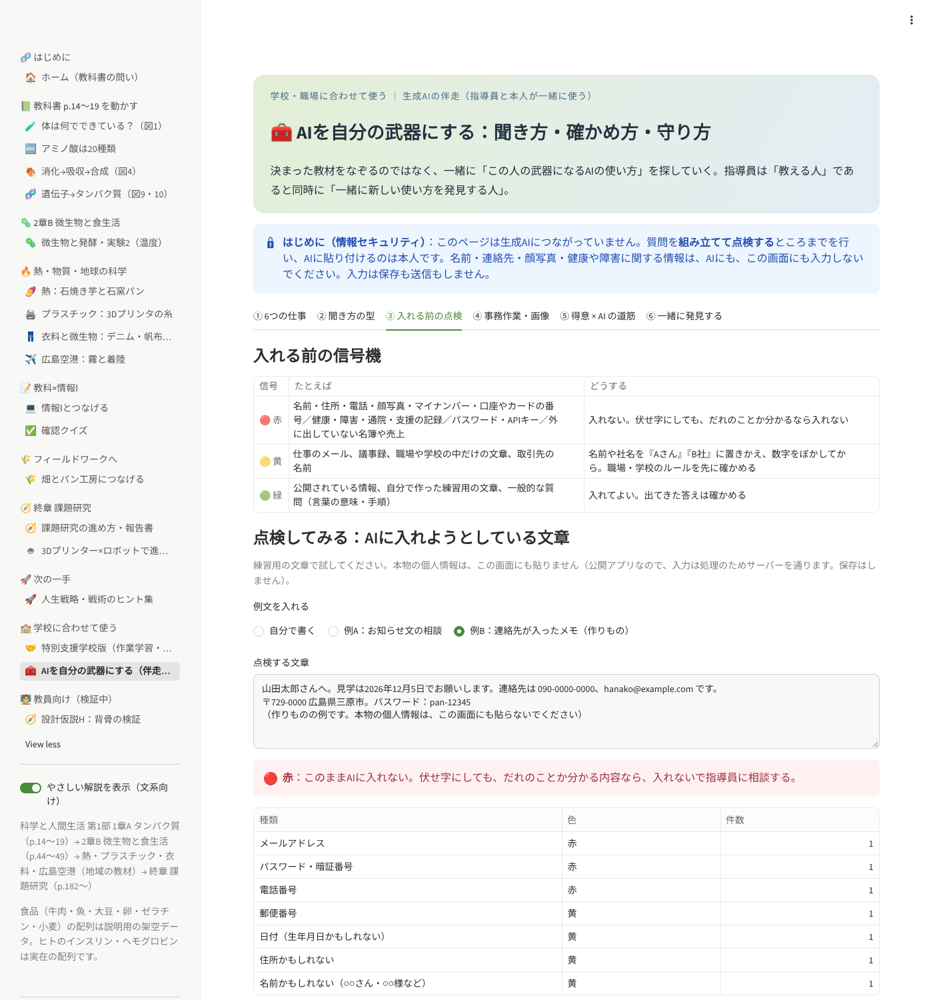
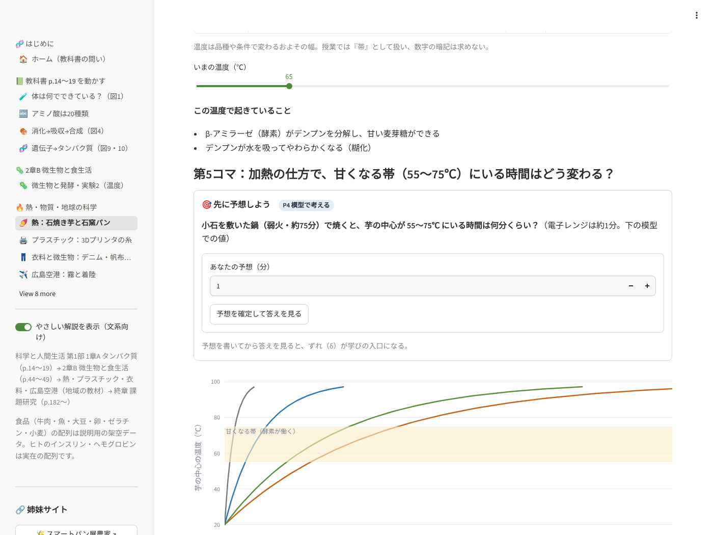
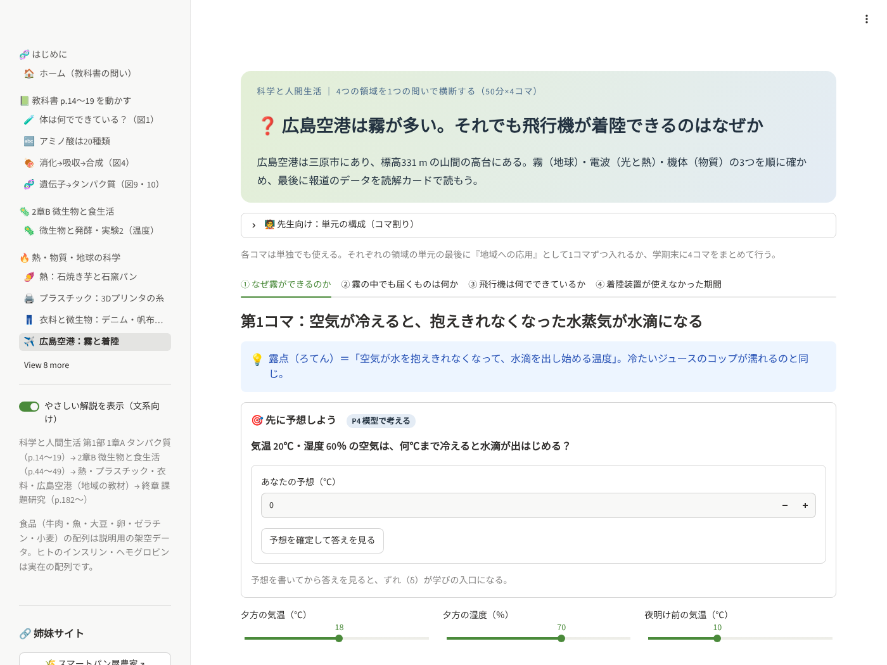

# 体をつくるタンパク質 → 微生物 → 熱・物質・地球 → 課題研究 ― 「科学と人間生活」×情報Ⅰ インタラクティブ教材

**▶ 公開ダッシュボード：<https://science-and-our-daily-life-dashboard-eemy7afzawym4gn656fjat.streamlit.app/>**


高校「科学と人間生活」第1部 生命の科学 1章A「タンパク質と遺伝子」① **体をつくるタンパク質**（教科書 p.14〜15）と
③ **タンパク質の合成**（p.18〜19）を、
Python と Streamlit で動かして確かめる教材です。

> ❓ **動物の肉を食べても、その動物にならないのはなぜだろうか。**

この問いに、**「① 計算する → ② 見える化する → ③ 自分で判断する」** の3段で答え、
最後に **🚀 次の一手：今後の人生戦略・戦術を立案する際のヒント集** へ持ち出します。
文系の生徒でも読めるよう、左メニューの「やさしい解説」スイッチで説明を出し入れできます。

## 🏫 この教材を使う4つの場面（2026-11 追加）

同じページを、学校の種類に合わせて使い分けます。上から順に、いちばん使いやすい場面です（ホーム画面にも同じ表があります）。

| 順 | 場面 | 使うページ | 使い方のこつ |
|---|---|---|---|
| 1 | **高校「科学と人間生活」の授業**（本命） | ホーム → 🧪 → 🍖 → 🧬 → ✅（50分1コマ） | 「やさしい解説」をONのまま。予想 → ずれ（δ）で考えさせる |
| 2 | **特別支援学校 高等部**（作業学習とつなぐ） | 🤝 特別支援学校版 ／ 🦠 微生物と発酵・実験2 ／ 🌾 畑とパン工房につなげる | 計算は先生が画面で見せ、生徒は「温度でパンのふくらみが変わる」理由だけをつかむ。食品加工（パン製造）・農業の作業と結びつける |
| 3 | **情報Ⅰの授業**（T2として補助） | 💻 情報Ⅰとつなげる ／ 🦠 の傾き・回帰直線 | 授業の主役は情報科の先生。理科の題材（コドン表・実験2のデータ）を例題として渡す |
| 4 | **生成AIの伴走**（指導員と本人が一緒に使う） | 🧰 AIを自分の武器にする | 決まった教材をなぞらず、「まず自分で → AIと → くらべる」の3歩で、その人の武器になる使い方を一緒に探す。名前・連絡先・健康に関する情報はAIに入れない |

作成者は高等学校教諭一種免許（理科）を持ち、特別支援学校 高等部で作業学習（農業・食品加工）の実習助手を5年4か月務めました。
情報科の免許は単位を修得中のため、情報Ⅰでは補助（T2）の立場で関わります。

## 🧰 AIを自分の武器にする：伴走ワーク（2026-11-11 追加）

> 決まった教材をなぞるのではなく、一緒に「この人の武器になるAIの使い方」を探していく。
> 指導員は「教える人」であると同時に「一緒に新しい使い方を発見する人」。

この立ち位置を軸足にして、**情報セキュリティを先に固めたうえで**、生成AIの具体的な仕事を一緒に練習するページを足しました（`pages/18_ai.py`・`ai_core.py`）。
どの仕事も **① まず自分で → ② AIと → ③ くらべる** の3歩で進めます。ほかのページの「予想 → ずれ（δ）」と同じ形で、
くらべたときに「自分のほうがうまい所」がその人の武器になります。

| 6つの仕事 | 画面でできること | 守り方（情報セキュリティ） |
|---|---|---|
| ✍️ 文章作成・要約・アイデア出し | 質問の型（目的・背景・条件・出力の形・確かめ）を書くと、1つの質問に組み立つ | 組み立てた質問を自動で点検し、連絡先などが入っていれば貼り付け前に知らせる |
| 🎨 画像生成AIで素材づくり（SNS・販促物・成果物） | 画像の頼み方（何を・どこで・雰囲気・構図・入れないもの）を組み立てる | 「○○風」「ロゴ」「そっくり」に注意を出す。使う前の確認6項目（実在の人・既存の作品・画像内の文字・商用利用の決まり） |
| 🙋 「分からない」をどう聞くか | 「分からない」の5段階（何が分からないかも分からない → もっとよくしたい）ごとの聞き方 | 「分からないことは推測で書かず『分からない』と言って」を、質問に必ず入れる |
| 🗂️ 事務作業（議事録要約・メール下書き・データ整理） | 仕事ごとのひな形と、「入れる前に／出てきた後に」の確認 | 名前は『Aさん』『B社』に置きかえる。名簿や売上は貼らず、列名と作りものの数行だけ見せる |
| 🧩 一人ひとりの「得意」× AI の道筋 | 得意をえらぶと「AIに任せる下ごしらえ／自分がやる仕上げ（武器）／はじめの一歩」が出る。シートを保存 | 名前の欄は置かない。メモに連絡先が入っていたら伏せ字にして保存 |
| 🧑‍🏫 指導員自身もAIで訓練メニュー・教材をつくる | 訓練メニュー案（ねらい・題材・3歩・予想）を組み立てて保存 | 対象者の個人情報・支援の記録は入れない。実施前の確認3項目が必ず付く |

**一緒に発見する**（タブ⑥）：「使い方」と「役に立った／立たなかった回数」だけを数え、ベータ分布（ベイズ推論）で「役に立つ見込み」と
「まだ分からない幅」を出し、トンプソン抽出で次に試す使い方の目安を示します。成績のよい使い方（活用）だけでなく、まだ試していない使い方（探索）も
選ばれるので、指導員も知らなかった使い方が見つかる余地が残ります。数字は目安で、決めるのは本人と指導員です。
「AIを使ったら速くなった」と言えるかは、読解カード③（何をそろえ、何を変えたか）で確かめます（2回目は慣れて速くなる＝順番の効果がまぎれこむ）。



**このページがしないこと**：生成AIを呼び出しません（APIキーを持たず、外へ何も送りません）。質問を組み立てて点検するところまでで、AIに貼り付けるのは本人です。
入れる前の点検（`ai_core.scan()`）は決まった形を探すだけで見落としがあり、「見つからなかった」は「安全」を意味しません（画面にも明記）。

## 🧭 4つの領域へ広げる：地域の教材（2026-11-10 追加）

生命の科学（1章A・2章B）だけだった教材に、**光や熱・物質・宇宙や地球の科学**と、**終章の進路探究**、**特別支援学校版**を足しました。
もとになったのは6本の単元案（熱／プラスチック／衣料と微生物／広島空港／終章：3Dプリンター×ロボット／特別支援学校版）です。
題材はどれも広島（三原・福山・尾道）にあり、背骨（読解カード・P1〜P5・予想→ずれ δ）は今までのページと同じです。

| 新ページ | 領域 | 問い | やってみること | 情報Ⅰとのつながり |
|---|---|---|---|---|
| 🍠 熱：石焼き芋と石窯パン（`pages/12_netsu.py`） | 光や熱の科学 | なぜ石焼き芋は電子レンジより甘いのか | 熱量保存の計算（石・鉄・アルミ）・3つの伝わり方・**温度と時間の模型**・Brix の落とし穴 | 散布図・箱ひげ図、式を解く |
| 🖨️ プラスチック：3Dプリンタの糸（`pages/13_plastic.py`） | 物質の科学 | なぜPLAは熱に弱いのか。使い終わったらどうなるのか | 軟化の記録表・**充填率とたわみ（班のデータを入力 → 回帰直線）**・部品の素材えらび・分解試験 | 相関と因果（実験データと観察データ）、モデル化 |
| 👖 衣料と微生物：デニム・帆布と水（`pages/14_iryo.py`） | 物質 × 生命の科学 | 同じ綿なのに何が違うのか。染めた水はどうきれいになるのか | **織り方を2次元配列でつくる**・藍の還元と酸化・3条件の対照実験（2条件を選ぶと言えることが変わる） | 2次元配列と余り、順序尺度 |
| ✈️ 広島空港：霧と着陸（`pages/15_kuko.py`） | 4領域を横断 | 霧が多いのに、なぜ着陸できるのか | 露点と飽和水蒸気量・波長（対数の目盛り）・密度・**欠航データの分母を切りかえる** | 割合と分母、帯グラフ |
| 🤖 3Dプリンター×ロボットで進路探究（`pages/16_shinro.py`） | 終章 | 2040年、ロボットのどちら側にいるか | 17テーマの絞りこみ（変えるもの・そろえるもの・測るもの）・リスク＝起こりやすさ×被害・進路ワーク（保存） | アルゴリズム、情報セキュリティ（守る側） |
| 🤝 特別支援学校版（`pages/17_tokushi.py`） | 学校に合わせて使う | 理科で『なぜ』、作業学習で『やってみる』 | 4枚カード（みる・はかる・くらべる・つたえる）・年間計画・シールの棒グラフ・**支援の量の5段階 × 3場面（転移チェック）** | 記録する → 並べる → 伝える |

**単元どうしをつなぐ言葉**：熱・プラスチック・衣料の3単元は「高分子（鎖）・デンプン・生分解・微生物」でつながります。
デンプンは、芋やパンではおいしさの材料、糸では糊、排水では汚れ、微生物にとってはえさ、PLA では原料。
「同じ物質でも、場所と目的が役割を決める」は、2章Bの「発酵と腐敗」と同じ見方です（`sozai_core.STARCH_FACES`・`BRIDGE`）。

**共通テスト型問題**：単元案の例題4問（物理基礎の熱量計算1問、対照実験の設計3問）を、各ページに `ui.exam_question()` で置きました。





## 🗺️ 高所・大所から見た全体像（2026-11 追加）

1章A だけの教材から、**1章A タンパク質 → 2章B 微生物と人間の食生活（p.44〜49）→ 終章 課題研究（p.182〜188・資料編）**
の3単元を、2本の背骨でつなぐ教材に広げました。

| 背骨 | 1章A タンパク質 | 2章B 微生物と食生活 | 終章 課題研究 |
|---|---|---|---|
| **内容**：分解して部品にし、設計図で組み直す | タンパク質 → アミノ酸 → 自分の遺伝子で並べ直す | 大豆タンパク質 → アミノ酸（しょう油のうま味）、糖 → エタノール＋CO₂（パン） | 自分の問いを「部品」に分けて調べる |
| **方法**：予想 → 条件を1つ変える → ずれ → ふり返る | ゼラチンの対照実験 | パスツールの白鳥の首フラスコ・実験2（温度） | 課題研究の9段階（「ふり返る」矢印） |
| **情報Ⅰ** | 文字列・辞書・場合の数 | 集合（図17）・傾き・回帰直線・SI接頭語と2進 | 情報の信ぴょう性・著作権・引用 |
| **FW（三原西部）** | 小麦のアミノ酸 | 天然酵母の発酵と温度 | 堆肥の分解・パンの保存をテーマに置きかえ |

| 新ページ | 教科書 | やってみること |
|---|---|---|
| 🦠 微生物と発酵・実験2（`pages/10_biseibutsu.py`） | p.44〜49・資料5〜6 | フラスコの条件を変える・図17を集合で分類・実験2の傾きと回帰直線・pH・有効数字・ミクロメーター |
| 🧭 課題研究の進め方・報告書（`pages/11_kadai.py`） | p.182〜188・資料1・7 | 9段階の流れ図・問いと仮説の型・報告書ビルダー（参考文献チェック）・安全チェック・盲斑の実験 |

確認クイズは12問（微生物3問を追加）、次の一手のヒントは15個（3個追加）になりました。

## 🚀 出発点の問い ➡︎ 次の一手

```
❓ 動物の肉を食べても、その動物にならないのはなぜだろうか
   ↓ 各ページで計算・可視化・判断
💡 答え（原理）：取り込んだものは部品に分解され、自分の設計図にしたがって組み直される
   ↓
🚀 次の一手：今後の人生戦略・戦術を立案する際のヒント集
```

- **各ページの最後に「🏷️ 次の一手」タグ**：そのページで確かめた事実を、**戦略**（何を選び、何を捨てるか）と
  **戦術**（今週なにをするか）に持ち出すヒントを1つ表示（`ui.next_move_tag()`）。
- **最終ページ「🚀 次の一手」**（`pages/9_next.py`）：時期と悩みを選ぶと、15のヒントを合う順に並べ、
  探索（新しいことを試す）と活用（できることで得点する）の配分の目安を表示。
  「戦略・自分の必須アミノ酸・組み合わせる相手・今週の戦術・予想」を書く**次の一手シート**をテキストで保存できる。

| ヒント（抜粋） | 生物での事実 | 出どころ |
|---|---|---|
| 材料は外から、設計図は自分の中 | 食べたタンパク質は分解され、自分の遺伝子で並べ直される | 消化→吸収→合成 |
| 必須なのに自分でつくれないものを先に確保する | 必須アミノ酸は食べ物からとるしかない | アミノ酸は20種類 |
| いちばん足りないものが全体を止める | トリプトファンが1個足りないだけで合成できない | 消化→吸収→合成 |
| 足りないものは組み合わせで補う | 小麦＋大豆でリシン不足を補う（補足効果） | 畑とパン工房 |
| 少ない種類でも、並べ方で唯一の自分になる | 20種類でも4個並べれば16万通り | 情報Ⅰとつなげる |
| 小さな書きかえを、安く・たくさん試す | 1文字の変異で同義・置換・短縮 | 遺伝子→タンパク質 |

ヒントは**比喩**で、生物学の事実が人生の正解を決めるわけではありません（ページにも「比喩としての限界」を明記）。
データは `next_move.py`（Streamlit 非依存、`python next_move.py` で自己チェック）。

## 🦴 全ページ共通の「背骨」（思考の型）

教える内容はページごとに変わっても、**生徒が使う思考の型は最初から最後まで同じ**にしています
（「科学探究・フィールドワーク 連動指導ロードマップ」の背骨）。

| 背骨 | このダッシュボードでの形 | 置き場所 |
|---|---|---|
| ① 読解カード（4項目：軸・単位・統制・言える／言えない） | 各ページの **🔎 読解カード**。問いを先に見せ、答えは自分で考えてから開く | `ui.reading_card()` |
| ② 認知プロトコル P1〜P5 | 読解カード・予想・クイズに **P1〜P5 のラベル**。クイズはP別に正答数を出す | `backbone.PROTOCOLS` |
| 測る前に予想する（仮説シート項目5） | **🎯 先に予想しよう**（図1・遺伝子・情報Ⅰ）。答えとのずれ **δ** を表示 | `ui.predict()` |
| 「なぜ言えないか」で評価する | クイズの P3・P4 で理由を書く欄、**共通テスト型問題づくり**、転移チェック | `pages/6_quiz.py` |

### 🧭 教員向け：暫定的な設計仮説H（検証中）

左メニュー最下段「🧑‍🏫 教員向け（検証中）」。**合言葉で保護**しています（下の「保護（プロテクト）」参照）。**生徒に教える内容ではなく、教員側の設計原理**で、しかも**検証中の暫定仮説**です。

> H：「生徒が使う思考の型を最初から最後まで同じにすると、『楽しい思い出』が『得点』に変わる」という仕組みは、
> 深層強化学習の**共有方策＋経験再生＋転移**としてうまく説明できる。

| タブ | できること |
|---|---|
| ① 対応表と実装箇所 | DRLの構成要素 ↔ ロードマップ ↔ **このダッシュボードのどこに実装したか** |
| ② 誤差ログと経験再生 | FWの例＋このセッションの予想から δ を計算し、**ずれの大きい経験ほど復習に出やすい**（優先度 (δ+0.01)^α）。JSONで手元に保存 |
| ③ 自己評価と教員評価の差 | P1〜P5 の A/B/C の差（Actor–Critic）。差が最大の観点＝個別指導の入口 |
| ④ 仮説の判定 | 予測①〜④の結果から **維持／縮小／棄却／保留** を判定（①が不支持なら棄却。④は参考） |
| ⑤ 暫定ルールと比喩の限界 | ルール3つと、それぞれの実装箇所。DRLの比喩が生徒に当てはまらない点 |

得点への寄与が大きいのは対応表の上3行（読み方と型を全ページで共通にすること）。経験再生などの実装は、
研究テーマ・生徒に見せる実例という位置づけにとどめています。

## 🔗 教材ネットワーク：姉妹サイト「スマートパン屋農家」

| | 🧬 体をつくるタンパク質（このリポジトリ・[公開アプリ](https://science-and-our-daily-life-dashboard-eemy7afzawym4gn656fjat.streamlit.app/)） | 🌾 [スマートパン屋農家](https://github.com/nayukaya3-cn/Smart-Bakery-Farmer_20260923)（[公開アプリ](https://smart-bakery-farm.streamlit.app/)） |
|---|---|---|
| 役割 | **教室**：教科書の1単元を Python で動かす（事前学習） | **現場**：畑・ハウス・パン工房で確かめる（フィールドワーク） |
| 3段構え | ① 計算する・② 見える化する | ③ 自分の条件で判断する |

教室で計算し、現場で判断し、現場で湧いた問いを教室でもう一度計算する。この往復を、ページどうしのリンクとして
**`sister_sites.py`（両リポジトリで同じ内容）** に1か所で定義しています。

| このサイトのページ | ⇄ | 姉妹サイトのページ | 共通の単元（学習指導要領の小項目） |
|---|---|---|---|
| 🏠 ホーム | ⇄ | 🏠 ホーム | ─ |
| 🍖 消化→吸収→合成 | ⇄ | 🔭 科学と人間生活＝FWの事前学習 | 衣料と食品／ヒトの生命現象 |
| 🌾 畑とパン工房につなげる | ⇄ | 🧭 フィールドワーク伴走 | 衣料と食品／ヒトの生命現象 |
| 🧬 遺伝子→タンパク質 | ⇄ | 🦠 微生物からの挑戦 | 微生物とその利用 |
| 💻 情報Ⅰとつなげる | ⇄ | 🔬 共通テスト『理科』を情報Ⅰで解く | ─ |

`sister_sites.py` を直したら、もう一方のリポジトリにも同じ内容でコピーし、`NETWORK_VERSION` を上げてください。
リンク先のページが実在するかは、各リポジトリのテストが確かめます（存在しないURLは相手のホームに飛んでしまうため）。

## ページ構成

| まとまり | ページ | 教科書 | やってみること | 情報Ⅰとのつながり |
|---|---|---|---|---|
| 🧬 はじめに | 🏠 ホーム | 導入の問い | 答えの見通し・背骨（読解カードとP1〜P5） | ─ |
| 📗 教科書を動かす | 🧪 体は何でできている？ | p.14 図1 細胞の成分 | 予想 → 「水を除く」スイッチ | データの可視化・割合（分母） |
| | 🔤 アミノ酸は20種類 | p.15 アミノ酸20種 | 必須アミノ酸を絞り込む | 文字コード |
| | 🍖 消化→吸収→合成 | p.15 図4・p.19 | 食べ物を変えて比べる（対照実験）・**どの食品から来たアミノ酸か** | 文字列の分解・辞書で集計 |
| | 🧬 遺伝子→タンパク質 | p.18〜19 図9・図10 | 塩基を1文字書きかえる・**鋳型鎖（相補性）**・**全部試す（総当たり）** | 対応表による変換・総当たり |
| 📝 教科×情報Ⅰ | 💻 情報Ⅰとつなげる | ─ | 予想 → 並べ方の数 20ⁿ とビット数 | 場合の数・情報量・DNCL |
| | ✅ 確認クイズ | ─ | 12問（P1〜P5別の集計）・理由を書く・問題づくり・転移チェック | ─ |
| 🔥 熱・物質・地球の科学 | 🍠 熱：石焼き芋と石窯パン | 単元案（8コマ） | 熱量保存・温度と時間の模型・Brix | 散布図・箱ひげ図 |
| | 🖨️ プラスチック：3Dプリンタの糸 | 単元案（8＋1コマ） | 軟化の記録表・充填率とたわみ・分解試験 | 回帰直線・相関と因果 |
| | 👖 衣料と微生物：デニム・帆布と水 | 単元案（7コマ） | 織り方・藍染め・3条件の対照実験 | 2次元配列と余り |
| | ✈️ 広島空港：霧と着陸 | 単元案（4コマ） | 露点・波長・密度・欠航データ | 割合と分母 |
| 🌾 フィールドワークへ | 🌾 畑とパン工房につなげる | 事前学習 | 補足効果・問いのブリッジ・**FWの予想シート（CSV）** | 条件をそろえた比較 |
| 🚀 次の一手 | 🚀 人生戦略・戦術のヒント集 | ─ | 時期・悩みに合うヒント、探索と活用の配分、次の一手シート | 並べ替え（スコア順） |
| 🧭 終章 課題研究 | 🧭 課題研究の進め方・報告書 | p.182〜188 | 9段階・報告書ビルダー・安全チェック | 情報の信ぴょう性・引用 |
| | 🤖 3Dプリンター×ロボットで進路探究 | 単元案（14コマ＋校外1日） | 17テーマ・リスクの表・進路ワーク | アルゴリズム・セキュリティ |
| 🏫 学校に合わせて使う | 🤝 特別支援学校版 | カリキュラム案 | 4枚カード・年間計画・支援の量の記録 | 記録する→並べる→伝える |
| | 🧰 AIを自分の武器にする（伴走ワーク） | ─ | 聞き方の型・入れる前の点検・得意×AIの道筋・試した記録 | 情報セキュリティ・個人情報・探索と活用 |
| 🧑‍🏫 教員向け | 🧭 設計仮説H：背骨の検証 | ─ | 対応表・経験再生・Actor–Critic・判定 | 優先度付き抽選・確率 |


## 手元で動かす

```bash
git clone https://github.com/nayukaya3-cn/Science-and-Our-Daily-Life-dashboard.git
cd Science-and-Our-Daily-Life-dashboard
python -m venv .venv && source .venv/bin/activate   # Windows: .venv\Scripts\activate
pip install -r requirements.txt
streamlit run app.py
```

## Streamlit Community Cloud で公開する

1. このフォルダを GitHub に新しいリポジトリとして push する
2. <https://share.streamlit.io/> → **Create app** → リポジトリ・ブランチ `main`・Main file path に **`app.py`** を指定
3. App URL（例：`tanpakushitsu.streamlit.app`）を決めて **Deploy**
4. README 冒頭の URL を書きかえる

5. **教員ページの合言葉**：アプリの **Settings → Secrets** に次の1行を書く（8文字以上。設定しないと教員ページは誰にも開きません）

   ```toml
   teacher_passcode = "ここに8文字以上の合言葉"
   ```

   手元では `TEACHER_PASSCODE=合言葉 streamlit run app.py` でも開けます。合言葉はリポジトリに書かないでください。

## ファイル構成

```
app.py              入口（左メニューの組み立て。ページを足すときは NAV に1行足す）
home.py             ホーム（3単元の全体地図）
bisei_core.py       2章B 微生物と食生活の計算部品とデータ。`python bisei_core.py` で自己チェック
kadai_core.py       終章 課題研究（9段階・報告書・参考文献チェック・安全）。`python kadai_core.py` で自己チェック
netsu_core.py       熱（石焼き芋と石窯パン）：熱量保存・温度帯・中心温度の模型・Brix。`python netsu_core.py` で自己チェック
sozai_core.py       物質（プラスチック／衣料と微生物）：軟化の目安・回帰直線・分解試験・織り方・藍・対照実験。自己チェックあり
kuko_core.py        広島空港：露点・飽和水蒸気量・波長・密度・欠航データ。自己チェックあり
shinro_core.py      終章の進路探究：18分野・17テーマ・6つの関わり方・リスクの表・進路ワーク。自己チェックあり
tokushi_core.py     特別支援学校版：4枚カード・年間計画・授業例・支援の量の5段階と転移チェック。自己チェックあり
ai_core.py          AI伴走ワーク：6つの仕事・質問の型・入れる前の点検（伏せ字）・得意×AIの道筋・試した記録（ベータ分布）。自己チェックあり
guard.py            保護の部品（合言葉の比較・CSVインジェクション対策・入力の安全化）
pages/              各ページ（1_seibun.py 〜 7_field.py、教員向け 8_kyoin.py、次の一手 9_next.py、10_biseibutsu.py、11_kadai.py、
                    地域の教材 12_netsu.py 〜 15_kuko.py、16_shinro.py、17_tokushi.py、AI伴走 18_ai.py）
sister_sites.py     姉妹サイト（教材ネットワーク）の定義。両リポジトリで同じ内容
tanpaku_core.py     計算部品とデータ（Streamlit に依存しない。`python tanpaku_core.py` で自己チェック）
next_move.py        次の一手（人生戦略・戦術のヒント集とページごとのタグ）。`python next_move.py` で自己チェック
backbone.py         背骨（読解カード・P1〜P5）と設計仮説H（δ・経験再生・判定）。`python backbone.py` で自己チェック
ui.py               画面の共通部品（見出しカード・やさしい解説・アミノ酸の鎖・読解カード・予想→δ）
tests/              pytest（計算のテスト＋全ページの描画テスト）
.streamlit/         公開用のセキュリティ設定
.github/            CI（テスト）・脆弱性スキャン・CodeQL・Dependabot・CODEOWNERS
```

## データについて（必ずお読みください）

| データ | 種類 |
|---|---|
| 細胞の成分：水67％・タンパク質15％ | 教科書の値 |
| 細胞の成分：脂質・無機塩類など | 教科書の図から読み取った**目安** |
| ヒトのインスリンA鎖・B鎖、ヘモグロビンβ鎖（先頭30個） | 実在の配列 |
| コラーゲン | 「G-P-○」のくり返しを示す**説明用の断片** |
| 牛肉・魚・大豆・卵・ゼラチン・パン用小麦のタンパク質 | **説明用の架空データ**（ゼラチンがトリプトファンを含まない点、小麦がグルタミン・プロリンに富みリシンに乏しい点は実際の性質。小麦のリシンは差を見やすくするため0にしている） |
| 実験2（アルコール発酵と温度）の気体の量・図17の分類・ミクロメーターの計算例 | 教科書の値（30℃・22分の値は写真で不鮮明なため 8.5 と読み取り） |
| 比熱容量・熱量保存の式、飽和水蒸気量・露点の式、波長＝速さ÷振動数、密度 | 理科基礎の標準的な値と式（露点は気象で使われる近似式。20℃で約17.3 g/m³ になることをテストで確認） |
| 芋の中心温度の上がり方（熱のページ） | **説明用の模型**（100℃へだんだん近づく、と単純化）。実測ではない |
| 軟化の目安（PLA 60℃・PETG 80℃）、分解試験・デンプン液の「見込み」 | 単元案の「予想される結果」。**授業では自分たちの測定値で置きかえる**（表に直接入力できる） |
| 充填率とたわみ、ヨウ素液の色、袋のふくらみの初期値 | **説明用の例** |
| 広島空港の欠航（3,255便・59便・14便）、標高331 m | 2015年の報道による（単元案の出典）。現在の運用や便数は変わっているので、最新の資料で確かめてから使う |
| 2040年の導入目標・18分野・職業の事例 | 単元案が引用する公開資料（2026年時点）。改定されることがあるので授業前に確認。事例は会社名を出さず一般的な書き方にしている |
| 産業用ロボット特別教育の時間数・18歳未満の扱い | **未確定**。実施前に条文と労働基準監督署で確認する（画面にも明記） |
| 遺伝子（DNA） | 各アミノ酸の代表コドンで組み立てた**説明用**のもの。実際の遺伝子とは塩基配列が異なる |

教科書の紙面画像・スキャンはリポジトリに入れないでください（著作物のため。`.gitignore` で `*.pdf`・`*.jpg`・`*.heic`・`IMG_*`・`*.zip`・`textbook/` を除外し、`tests/test_security.py` でも確認しています）。

## テスト

```bash
pip install pytest
python tanpaku_core.py   # 自己チェック
python backbone.py       # 自己チェック（背骨・仮説H）
python next_move.py      # 自己チェック（次の一手）
python bisei_core.py     # 自己チェック（微生物）
python kadai_core.py     # 自己チェック（課題研究）
python netsu_core.py && python sozai_core.py && python kuko_core.py   # 自己チェック（熱・物質・空港）
python shinro_core.py && python tokushi_core.py                      # 自己チェック（終章の進路探究・特別支援学校版）
python ai_core.py        # 自己チェック（AI伴走ワーク：質問の型・入れる前の点検）
python guard.py          # 自己チェック（保護）
pytest -q                # 計算＋全ページの描画＋保護
```

GitHub に push すると `.github/workflows/ci.yml` が同じテストを自動で実行します。

## プライバシー

入力（スイッチ・選択・クイズの回答・予想・教員ページの評価）は閲覧中のセッションの中だけで使い、保存も送信もしません
（「保存」ボタンは手元へのダウンロードだけ）。学習ログを研究に使う場合は、実施前に保護者同意と研究倫理審査が必要です。詳しくは [SECURITY.md](SECURITY.md)。
